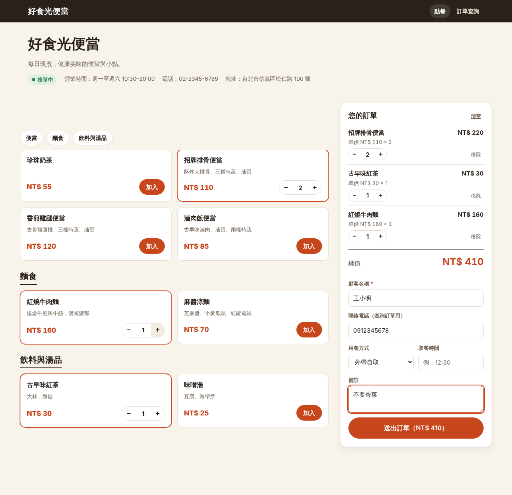
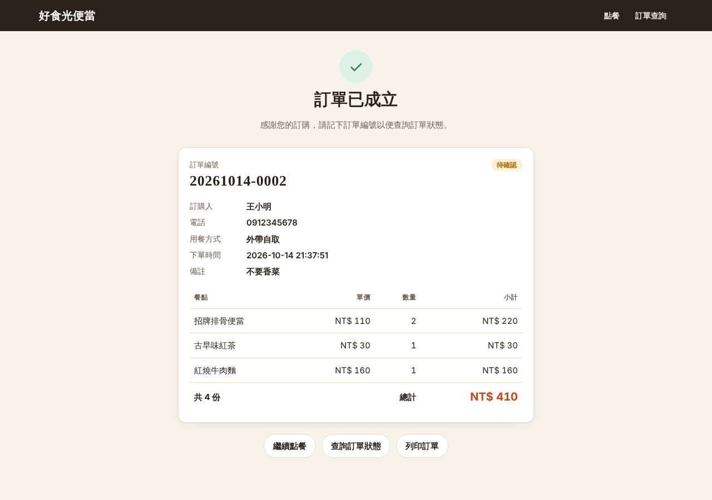
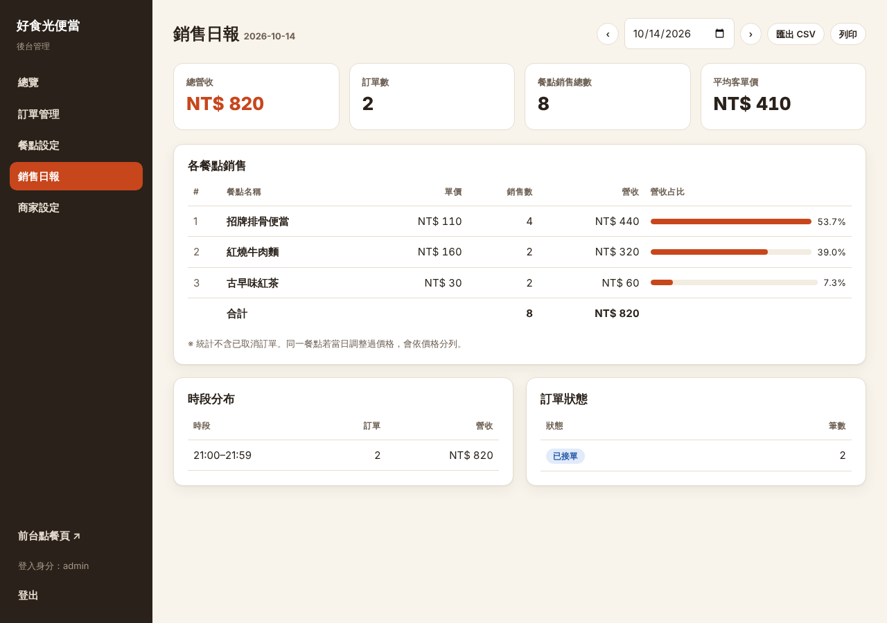

# 線上訂餐系統（Food Ordering System）

一套給小型餐飲店使用的線上訂餐網站，包含**前台點餐**與**後台管理**。
以 Node.js 內建 `node:http` 開發，資料存在 **MongoDB**，唯一的執行期相依套件是官方 `mongodb` driver。



## 功能

### 前台（顧客）

| 頁面 | 網址 | 說明 |
|---|---|---|
| 點餐頁 | `/` | 顯示商家資訊、營業狀態與公告；依分類瀏覽餐點，加入購物車並調整數量；購物車即時顯示**單價、各品項小計與總價**；輸入顧客名稱（必填）、電話、用餐方式、取餐時間、備註後送出 |
| 訂單成立 | `/order?no=…&t=…` | 呈現完整訂單資訊：訂單編號、狀態、訂購人、電話、用餐方式、下單時間、備註、每項餐點的單價／數量／小計、總計，可列印；網址含專屬存取碼，可加入書籤或分享給同行者 |
| 訂單查詢 | `/track` | 以「訂單編號 + 訂購人姓名或電話」查詢單筆訂單，或以「電話 + 姓名」查詢最近 20 筆訂單，可看到目前處理狀態 |

### 後台（店家）— `/admin/`

| 頁面 | 說明 |
|---|---|
| 總覽 | 今日訂單數、營收、平均客單價、待處理訂單數、最新訂單、今日熱銷；一鍵開／關線上接單；每 30 秒自動更新 |
| 訂單管理 | 依日期、狀態、關鍵字（編號／姓名／電話）篩選；查看訂單明細；依流程更新狀態：待確認 → 已接單 → 製作中 → 可取餐 → 已完成，或取消 |
| 餐點設定 | 新增／編輯／刪除餐點（名稱、價格、分類、說明、圖片網址、排序），一鍵切換供應中／停售；管理分類與排序、是否在前台顯示 |
| 銷售日報 | 選擇日期，呈現**各餐點銷售數、各餐點營收、營收占比、總營收**，以及訂單數、平均客單價、時段分布、訂單狀態統計；可匯出 CSV（Excel 可直接開啟）或列印 |
| 商家設定 | 商家名稱、電話、地址、營業時間、介紹、前台公告、是否開放接單（管理員帳密由環境變數設定） |

<p>
  
  
</p>

## 快速開始

需求：**Node.js 22 以上**、一個 MongoDB（本機、Docker 或雲端皆可）。

```bash
git clone https://github.com/frank000210/food-ordering-system.git
cd food-ordering-system
npm install
cp .env.example .env   # 填入 MONGODB_URI 與 ADMIN_PASSWORD
npm run dev
```

- 前台：http://localhost:3000
- 後台：http://localhost:3000/admin/ （帳號 `ADMIN`、密碼 `ADMIN_PASSWORD`）

第一次連上空資料庫時會自動建立索引、商家預設設定，並放入一組示範菜單（便當、麵食、飲料與湯品）。

## 環境變數

| 變數 | 預設值 | 說明 |
|---|---|---|
| `MONGODB_URI` | （必填） | MongoDB 連線字串 |
| `MONGODB_DB` | `food_ordering` | 資料庫名稱 |
| `ADMIN` / `ADMIN_PASSWORD` | `admin` / （必填） | 後台帳號密碼。**每次登入都直接比對環境變數**，不存資料庫；未設定密碼時後台無法登入。改帳號後舊的登入工作階段自動失效 |
| `ADMIN_AUTH_DISABLED` | `0` | **僅限測試期間**：設為 `1` 時後台不需登入即可使用。正式營運前務必移除 |
| `PORT` | `3000` | 服務埠號 |
| `STOREFRONT_URL` | — | 顧客點餐網址，例如 `https://food-ordering.zeabur.app` |
| `ADMIN_URL` | — | 店家後台網址，例如 `https://food-ordering-admin.zeabur.app`。設定後**前台網域看不到後台**（`/admin`、`/api/admin` 回 404），後台網域的 `/` 導向 `/admin/` |
| `STORE_TIMEZONE` | `Asia/Taipei` | 訂單日期與日報使用的時區 |
| `SEED_DEMO` | `1` | 設為 `0` 則不建立示範菜單 |
| `COOKIE_SECURE` | `0` | 透過 HTTPS 提供服務時設為 `1`（Cookie 加 Secure、送 HSTS） |
| `TRUST_PROXY` | `0` | 放在反向代理（如 Zeabur）後面時設為 `1`，登入限流才會依真實用戶 IP 計算 |

## 部署到 Zeabur

1. 以 GitHub 連結此 repo，Zeabur 會使用根目錄的 `Dockerfile` 建置。
2. 設定上表的環境變數（至少 `MONGODB_URI`、`ADMIN_PASSWORD`、`COOKIE_SECURE=1`、`TRUST_PROXY=1`）。
3. 在同一個服務綁兩個網域：一個給顧客（填入 `STOREFRONT_URL`），一個給店家（填入 `ADMIN_URL`）。

## 設計重點

- **價格以伺服器為準**：下單時只送餐點 ID 與數量，單價、小計、總價都由後端依資料庫計算，前端無法竄改金額。
- **訂單明細保存快照**：訂單會記下當下的餐點名稱與單價，之後改價或刪除餐點都不會影響歷史訂單與報表。
- **銷售日報排除取消訂單**；同一天若調整過價格，同一餐點會依不同單價分列。
- **訂單編號**為「日期-當日流水號」，例如 `20261014-0001`，以 MongoDB 原子計數器產生，同時下單也不會重號。
- **安全性**：後台帳密來自環境變數、以固定時間比對；session 存在 MongoDB（TTL 自動過期），使用 HttpOnly + SameSite Cookie；寫入類 API 只接受 JSON（阻擋跨站表單送出）；登入失敗 5 次鎖 15 分鐘；只憑電話查不到他人訂單；CSV 匯出防公式注入；所有輸出皆經 HTML 跳脫。
- 介面支援手機版（底部購物車面板）與列印。

## 專案結構

```
src/
  server.js     啟動 HTTP 服務
  app.js        API 路由（前台、後台）
  router.js     輕量路由器（路徑參數、JSON、靜態檔案）
  services.js   訂單、菜單、報表等商業邏輯
  db.js         MongoDB 連線、索引、計數器、初始資料
  auth.js       環境變數帳密、session、登入限流
  time.js       店家時區的日期時間
public/
  index.html    點餐頁
  order.html    訂單成立頁
  track.html    訂單查詢
  assets/       共用樣式與前台程式
  admin/        後台頁面（總覽、訂單、餐點、日報、商家設定、登入）
test/
  api.test.js   API 自動化測試
```

## API 一覽

前台（不需登入）

| 方法 | 路徑 | 說明 |
|---|---|---|
| GET | `/api/menu` | 商家資訊與可供應的菜單 |
| POST | `/api/orders` | 建立訂單 `{ customer_name, customer_phone, order_type, pickup_time, note, items: [{ menu_item_id, quantity }] }` |
| GET | `/api/orders/view` | `?no=&t=` 訂單成立頁（訂單編號 + 下單時回傳的 `access_token`） |
| GET | `/api/orders/lookup` | `?order_no=&contact=` 或 `?phone=&name=` |

後台（需登入，路徑前綴 `/api/admin`）

| 方法 | 路徑 | 說明 |
|---|---|---|
| POST | `/login`、`/logout` | 登入、登出 |
| GET | `/dashboard` | 今日總覽 |
| GET / PUT | `/store` | 商家設定 |
| GET / POST / PUT / DELETE | `/categories`、`/categories/:id` | 分類 |
| GET / POST / PUT / DELETE | `/items`、`/items/:id` | 餐點；`PATCH /items/:id/availability` 切換供應 |
| GET | `/orders?date=&status=&q=`、`/orders/:id` | 訂單列表與明細 |
| PATCH | `/orders/:id/status` | 更新訂單狀態 |
| GET | `/reports/daily?date=`、`/reports/daily.csv?date=` | 銷售日報、CSV 匯出 |

## 測試

```bash
npm test
```

測試使用 `mongodb-memory-server` 啟動暫時的記憶體 MongoDB，不會碰到正式資料庫（第一次執行會下載 mongod 執行檔）。
涵蓋：菜單、下單金額計算、輸入驗證、CSRF 防護、訂單成立頁存取碼、訂單查詢驗證、環境變數帳密、後台權限、餐點 CRUD、停售與暫停接單、訂單狀態流程、銷售日報數字、CSV 匯出與公式注入、前後台網域分流、靜態頁面與路徑穿越防護。

## 授權

MIT
